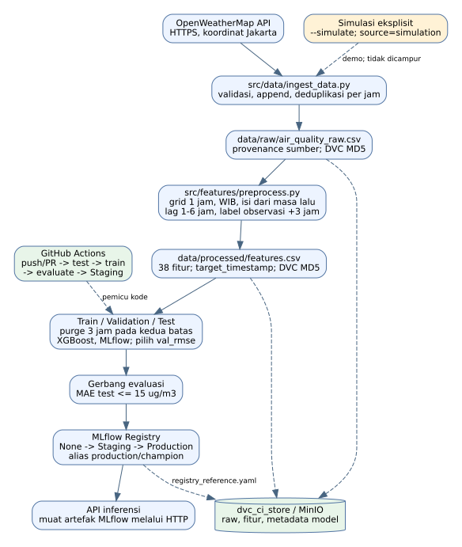

# MLOps Prediksi PM2.5 Jakarta

[](https://github.com/AlGibran18/MLOps-Prediksi-PM25-Jakarta/actions/workflows/mlops-automation.yaml)

Proyek regresi **XGBoost** untuk prediksi PM2.5 pada horizon **+3 jam**, memakai nilai polutan saat ini dan lag enam jam sebelumnya. Proyek mencakup ingestion, preprocessing, DVC, eksperimen MLflow, Model Registry, gerbang evaluasi, GitHub Actions, serta API yang diorkestrasi Docker Compose.

**Dataset demonstrasi yang disertakan berlabel `simulation`, bukan pengukuran aktual Jakarta.** Sumber aktual yang didukung adalah OpenWeatherMap pada koordinat pusat Jakarta (-6.2088, 106.8456). Satu titik merupakan batasan PoC. Metrik pada simulasi membuktikan proses dapat dijalankan ulang, bukan akurasi operasional kualitas udara Jakarta.

## Menjalankan seluruh layanan (LK-09)

Prasyarat: Docker Engine/Docker Desktop aktif dan Docker Compose v2. Dari root repositori:

```bash
docker compose up -d
```

Build pertama mengunduh image/dependensi. Tunggu kedua layanan `healthy` pada `docker compose ps`. Gunakan `docker compose up -d --build` setelah mengubah kode/dependensi.

| Layanan | Peran | Akses host |
|---|---|---|
| `mlflow-server` | Tracking, registry, SQLite, dan HTTP artifact proxy | http://localhost:5000 |
| `api-service` | Inferensi dari model Production | http://localhost:18000/docs |

Keduanya memakai custom bridge `mlops-network`. API menghubungi `http://mlflow-server:5000` melalui service discovery; `NO_PROXY` menjaga komunikasi internal tidak melewati proxy eksternal. `depends_on: condition: service_healthy` menunggu MLflow siap. Named volume `mlflow-data:/mlflow` menyimpan SQLite `/mlflow/mlflow.db` beserta artefak `/mlflow/artifacts`.

Registry Compose baru belum memiliki riwayat MLflow lokal sebelumnya. Startup pertama memverifikasi/pulihkan raw dan fitur dari cache DVC, menjalankan satu training dengan konfigurasi terpilih, evaluasi MAE, register, Staging, lalu Production. Startup berikutnya memakai model yang lineage dan protokolnya cocok. Jika dataset berubah, model baru disiapkan; model lama tidak diperlakukan seolah-olah dilatih pada dataset baru. Nomor versi/run ID pada clone baru dapat berbeda dari lingkungan bukti.

```bash
docker compose ps
curl http://localhost:18000/health
docker compose exec api-service python -c "import urllib.request; print(urllib.request.urlopen('http://mlflow-server:5000/health').read().decode())"
docker compose exec -T api-service python -c "import json; from src.models.train import load_data; X,_=load_data('data/processed/features.csv'); print(json.dumps({'instances':X.tail(1).to_dict(orient='records')}))" > request.json
curl -X POST http://localhost:18000/predict -H 'Content-Type: application/json' --data-binary @request.json
```

`POST /predict` menerima daftar `instances` dengan 38 fitur sesuai signature. Kolom kurang/berlebih, batch kosong, nilai non-finite, atau pecahan pada kolom integer ditolak HTTP 422. Respons berisi prediksi (`ug/m3`), horizon, dan versi model.

Untuk memeriksa persistensi, catat `/health`, jalankan `docker compose down` lalu `docker compose up -d`, tunggu healthy, dan bandingkan versi/run ID. `down` mempertahankan volume; opsi `down -v` menghapusnya. Laporan dan screenshot LK-09 disiapkan di luar repositori mengikuti template pemilik proyek.

## Codespaces dan pengujian (LK-02)

Pilih **Code → Codespaces → Create codespace on main**. `.devcontainer/devcontainer.json` memakai Python **3.12**, ekstensi Python/Pylance/Jupyter/Docker, dan otomatis memasang `requirements-dev.txt`. Dependensi core ML dipatok pada versi yang sama dengan image API. Alternatif instalasi manual:

```bash
python -m pip install -r requirements-dev.txt
dvc pull -r ci_remote
pytest -q
```

Tes tidak melewati kontrak dataset secara diam-diam: data DVC harus dipulihkan sebelum pytest. API key tidak diperlukan untuk dataset demo. Untuk data aktual, tambahkan `OWM_API_KEY` pada environment atau `.env` lokal yang diabaikan Git.

GitHub Flow: buat branch fitur/perbaikan, validasi, buka PR ke `main`, lalu merge setelah pemeriksaan berhasil. Riwayat awal tersedia pada [PR #1](https://github.com/AlGibran18/MLOps-Prediksi-PM25-Jakarta/pull/1) dari `feat/initial-eda`; perbaikan ini juga dikerjakan pada branch `fix/lk02-lk09-reproducibility`.

## Rancangan pipeline dan struktur (LK-03)



[Rencana teknis ETL, penanganan data, dan versioning](docs/architecture.md) · [Sumber diagram editable](docs/architecture.dot).

```text
.devcontainer/          Lingkungan Codespaces Python 3.12
.github/workflows/      Test → train → evaluate → registry Staging
configs/                Ambang evaluasi
src/data/               Ingestion aktual atau simulasi eksplisit
src/features/           Kontrak fitur dan preprocessing temporal
src/models/             Training, evaluasi, register, promosi, inferensi
src/api/                API prediksi
samples/                Contoh raw kecil dengan provenance
data/raw/              CSV raw beserta pointer DVC
data/processed/        CSV fitur beserta pointer DVC
models/                 Referensi registry yang dilacak DVC
dvc_ci_store/           Objek demo kecil untuk reproduksi tanpa MinIO
notebooks/              Tempat eksplorasi tambahan
tests/                  Pengujian data, temporal, lineage, gate, API
docs/                   Diagram, rencana pipeline, dan metadata teknis
Dockerfile              Target image server MLflow dan API
docker-compose.yaml     Dua layanan, network, volume, healthcheck
```

## Ingestion dan preprocessing (LK-04)

Data aktual menggunakan HTTPS dan API key lokal. Jika API gagal, skrip berhenti tanpa menimpa dataset dan tanpa menyamarkan simulasi sebagai data aktual. Setiap record mencatat sumber; observasi nontepat jam ditempatkan pada batas jam berikutnya agar tidak dimundurkan ke waktu sebelum observasi. `observed_at` asli tetap disimpan untuk API. Pengambilan ulang pada jam sama dideduplikasi; jam lain dipertahankan.

Contoh pengumpulan aktual ke berkas terpisah:

```bash
python -m src.data.ingest_data --output data/raw/air_quality_observed.csv
# Ulangi setiap jam; preprocessing memerlukan riwayat dan label masa depan yang cukup.
python -m src.features.preprocess --input data/raw/air_quality_observed.csv --output data/processed/features_observed.csv
```

Jangan mencampur aktual dan simulasi dalam satu CSV. Jika melatih dataset observasi terpisah, lacak kedua berkas dengan DVC dan gunakan `train --raw_path ... --data_path ... --experiment_name PM25-Jakarta-XGBoost-Observed`. Perbandingan kandidat dilakukan pada dataset/protokol yang sama.

Untuk mengulang demonstrasi **pada folder kosong**, gunakan dua periode berikut:

```bash
python -m src.data.ingest_data --simulate --start 2026-09-01T00:00:00Z --hours 168 --seed 42
# Versikan v1 sebelum menambah periode kedua.
dvc add data/raw/air_quality_raw.csv
python -m src.data.ingest_data --simulate --start 2026-09-08T00:00:00Z --hours 168 --seed 43
dvc add data/raw/air_quality_raw.csv
python -m src.features.preprocess
dvc add data/processed/features.csv
dvc push -r ci_remote
```

Dataset aktif berisi 336 jam raw dan 327 window lengkap. Preprocessing memakai grid satu jam; fitur kalender berdasarkan WIB; nilai hilang diisi hanya dari masa lalu maksimal dua jam. Label +3 jam tetap observasi asli, tidak diinterpolasi. Window/label tidak lengkap dibuang. [Sampel raw berlabel](samples/air_quality_simulation.csv).

## Data versioning dan lineage (LK-05)

[Perbandingan dua versi dan hash](docs/data_versioning.md). Default remote `ci_remote` menunjuk cache demo yang dilacak Git; `dvc pull` dapat memulihkan raw, fitur, dan metadata model tanpa kredensial. Penyimpanan objek kecil di Git hanya untuk reproduksi tugas, bukan pola untuk dataset produksi besar.

Remote opsional `minio_remote` sudah didefinisikan pada `.dvc/config`. Setelah MinIO aktif, buat bucket `mlops-dvc-storage`, set endpoint yang sesuai, dan simpan access/secret key menggunakan `dvc remote modify --local ...` atau environment. Jalankan `dvc push -r minio_remote`. Konfigurasi `.dvc/config.local` tidak di-commit. Endpoint `127.0.0.1:9000` hanya berlaku pada mesin tempat MinIO berjalan.

Training memeriksa checksum aktual raw dan fitur terhadap pointer `.dvc`. Ketidakcocokan menggagalkan training, bukan sekadar mencatat tag lama. MLflow mencatat kedua MD5, sumber data, protokol, batas waktu split, parameter, dan metrik. Referensi model aktif diekspor ke `models/registry_reference.yaml`, dilacak DVC, serta tersedia di cache.

## Eksperimen dan evaluasi (LK-06)

Gunakan MLflow server Compose yang sudah berjalan:

```bash
export MLFLOW_TRACKING_URI=http://localhost:5000
./run_experiments.sh
python -m src.models.register_best
```

Tanpa environment tersebut, CLI memakai database lokal `sqlite:///mlflow.db`; UI lokal dapat dibuka dengan `mlflow ui --backend-store-uri sqlite:///mlflow.db --port 5000` saat port bebas. Database/artefak runtime tidak di-commit ke Git.

Experiment baru: `PM25-Jakarta-XGBoost-Corrected`. Train/validation/test dibagi kronologis sekitar 60/20/20 sebelum memperhitungkan dua purge. Setiap batas dipisahkan minimal tiga jam. Label terakhir train harus lebih awal daripada origin validation; demikian juga validation terhadap test. Tidak ada median yang dihitung dari seluruh dataset. Model dipilih berdasarkan **validation RMSE**, sementara test hanya untuk laporan akhir dan gerbang kualitas. Baseline persistence turut dicatat.

| Run | Trees | LR | Depth | Validation RMSE | Test RMSE | Test MAE |
|---|---:|---:|---:|---:|---:|---:|
| run1-baseline | 50 | 0.1 | 3 | 2.4973 | 2.2208 | 1.8274 |
| run2-more-trees | 200 | 0.05 | 3 | 2.4430 | 2.3269 | 1.9164 |
| run3-deeper | 200 | 0.05 | 5 | 2.7283 | 2.5762 | 2.0715 |
| run4-regularized | 300 | 0.03 | 4 | 2.5787 | 2.2884 | 1.8598 |

Baseline persistence pada test MAE: **4.5608 ug/m3**. Angka di atas berasal dari simulasi berlabel, bukan evaluasi data aktual.

[Metadata hasil terpilih](docs/model_metadata.md) · [Metadata JSON semua run](docs/experiments.json). Screenshot dan laporan LK-06 dikumpulkan terpisah dari repo.

## Model Registry dan inferensi (LK-07)

Nama model: `pm25-xgboost`. Pada lingkungan bukti, versi **2** dari `run2-more-trees` menjadi Production dan memiliki alias `production`/`champion`; versi **3** adalah kandidat berbeda dari `run1-baseline`. Versi lama **1** diarsipkan. Nomor versi tidak disamakan dengan penamaan v1/v2 pada tugas karena registry ini telah memiliki versi sebelumnya.

```bash
python -m src.models.registry_ops register --run_name run1-baseline
python -m src.models.registry_ops list
python -m src.models.registry_ops promote --best --stage Staging
python -m src.models.registry_ops promote --best --stage Production
python -m src.models.registry_ops export
dvc add models/registry_reference.yaml
dvc push -r ci_remote
python -m src.models.inference_check
```

`--best` memilih validation RMSE terendah hanya dari dataset/protokol yang sama dengan pointer aktif. Promosi menolak run yang belum selesai, lineage/protokol yang salah, atau metrik yang gagal gerbang. Versi lama pada stage tujuan diarsipkan. Stage tetap digunakan untuk memenuhi LK, sedangkan alias tersedia karena API stage telah deprecated pada MLflow 3.x. Bukti screenshot dan log transisi untuk laporan LK-07 disimpan terpisah dari repo.

## Pemicu kode dan otomatisasi (LK-08)

Workflow `.github/workflows/mlops-automation.yaml` dipicu oleh push/PR pada perubahan kode, tes, konfigurasi, pointer dataset, dan dependensi. Tahapannya:

1. Pulihkan raw/fitur DVC, validasi manifest Compose, lalu jalankan seluruh pytest.
2. Tarik dataset DVC yang sama, latih model, dan catat ke MLflow.
3. Bandingkan test MAE dengan `mae_max: 15.0` di `configs/thresholds.yaml`; RMSE/R² dicatat, ambangnya tidak diaktifkan karena dokumen LK-01 yang dirujuk tidak menetapkannya.
4. Hanya jika evaluasi lolos, register model lalu pindahkan ke **Staging**. Database/artefak antarjob disimpan sebagai GitHub Actions artifacts.

Registry CI terpisah dari registry Production Compose: job CI memakai database sementara dan mengunggah hasil sebagai artifact dengan masa retensi. Ini bukan server registry bersama yang menyimpan seluruh histori lintas run. [Riwayat Actions](https://github.com/AlGibran18/MLOps-Prediksi-PM25-Jakarta/actions) · Refleksi dan bukti LK-08 ditulis pada laporan terpisah.

## Kelengkapan dan batas bukti

[Checklist luaran repo LK-02–LK-09](docs/assessment.md) memetakan instruksi ke berkas repo dan memisahkan kebutuhan laporan. Bukti eksekusi bertanggal pengerjaan sebenarnya. Pengujian API aktual OpenWeatherMap memerlukan API key sendiri; pengujian tanpa kredensial tidak dinyatakan sebagai koneksi aktual yang berhasil.

[Catatan koreksi lineage hasil lama](docs/legacy/README.md): hash lama yang tidak cocok dengan metadata tidak diganti seolah-olah benar. Eksperimen dan bukti baru menggunakan dataset terverifikasi. Repo memuat kode, konfigurasi, diagram, README, dan metadata teknis. Laporan akademik/PDF serta screenshot laporan berada di luar repo dan mengikuti template pemilik proyek; pengumpulan ke LMS dilakukan pemilik proyek.
