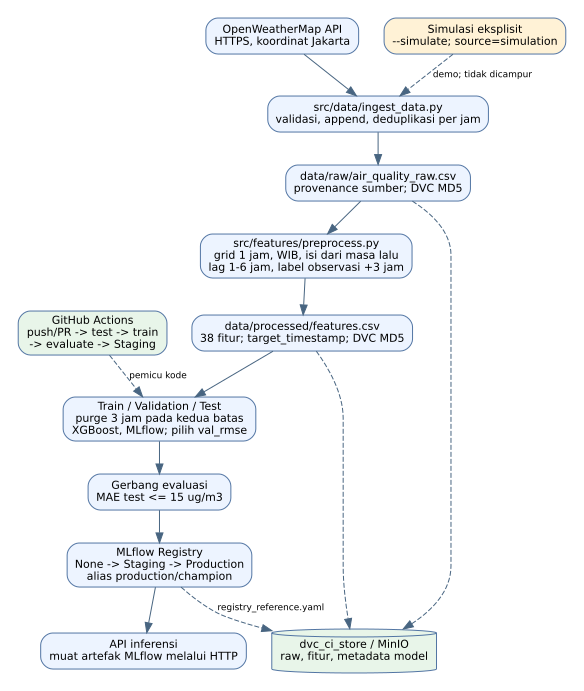

# LK-03 — Rancangan aliran data dan versioning

Diagram dapat diedit melalui [architecture.dot](architecture.dot). Diagram ini menunjukkan sumber eksternal masuk ke `data/` pada checkout repositori GitHub; dataset besar/artefak DVC dipisahkan dari riwayat kode Git.

## Extract

Sumber aktual: OpenWeatherMap Air Pollution API, endpoint HTTPS `/data/2.5/air_pollution`, koordinat -6.2088, 106.8456. Satu titik koordinat merupakan batasan PoC, bukan pengukuran seluruh wilayah Jakarta. `OWM_API_KEY` dibaca dari environment/.env dan tidak di-commit. Jalankan ingestion setiap jam atau ulangi skrip untuk simulasi pengambilan berkala. Observasi nontepat jam ditempatkan pada batas penutupan jam berikutnya (ceil), sehingga nilai tidak ditempatkan sebelum waktu pengamatan; `observed_at` asli disimpan untuk data API, nilai wajib divalidasi, dan jam duplikat diperbarui tanpa menghapus jam lain. HTTP gagal/missing component tidak menghasilkan nilai nol atau fallback diam-diam.

Untuk demonstrasi tanpa kredensial tersedia `--simulate`; CSV selalu mencatat `source=simulation`. Sumber aktual memakai `source=openweathermap`. Ingestion menolak pencampuran kedua sumber dalam satu file. Simulasi tidak menjadi bukti keberhasilan koneksi ke API aktual.

## Transform

Urutkan data UTC, tolak timestamp duplikat, bentuk grid per jam agar `shift(3)` benar-benar 3 jam. Konversi kalender ke `Asia/Jakarta` untuk fitur jam WIB dan encoding sinus/kosinus. Isi nilai fitur yang hilang hanya dari masa lalu (forward-fill maksimal dua jam). Label berasal dari observasi PM2.5 asli pada `target_timestamp=timestamp+3h`; label yang hilang tidak diimputasi. Bentuk 30 lag dari lima polutan, ditambah nilai saat ini dan kalender (38 fitur). Window/label tidak lengkap dibuang.

## Load dan lineage

Raw disimpan pada `data/raw/`, fitur pada `data/processed/`. `dvc add` menghasilkan pointer dengan MD5, kemudian `dvc push` menyalin objek ke remote. Repo memuat cache demonstrasi kecil `dvc_ci_store` supaya clone baru dapat direproduksi tanpa MinIO; remote S3 MinIO tetap tersedia sebagai pilihan. `git diff` pointer dan `dvc diff` mengaudit versi. Training memverifikasi checksum berkas terhadap pointer sebelum mencatat tag raw/feature MD5 ke MLflow. Metadata versi model diekspor dan dilacak DVC sehingga model dapat ditelusuri ke dua dataset tersebut.

## Batas waktu evaluasi dan operasi

Pisahkan train/validation/test menurut waktu, dengan purge minimal tiga sampel/jam sebelum validation dan test. Label terakhir tiap blok harus lebih awal daripada origin blok berikutnya. Pemilihan hyperparameter memakai `val_rmse`, bukan metrik test. Test digunakan untuk laporan akhir dan gerbang MAE yang dikonfigurasi. Simpan parameter, metrik, signature, baseline persistence, dan lineage di MLflow. GitHub Actions menjalankan pengujian, training, evaluasi, lalu Staging. Promosi Production memerlukan protokol yang valid dan lolos gerbang. API memuat model registry melalui jaringan Docker Compose; SQLite/artefak berada pada named volume server.
